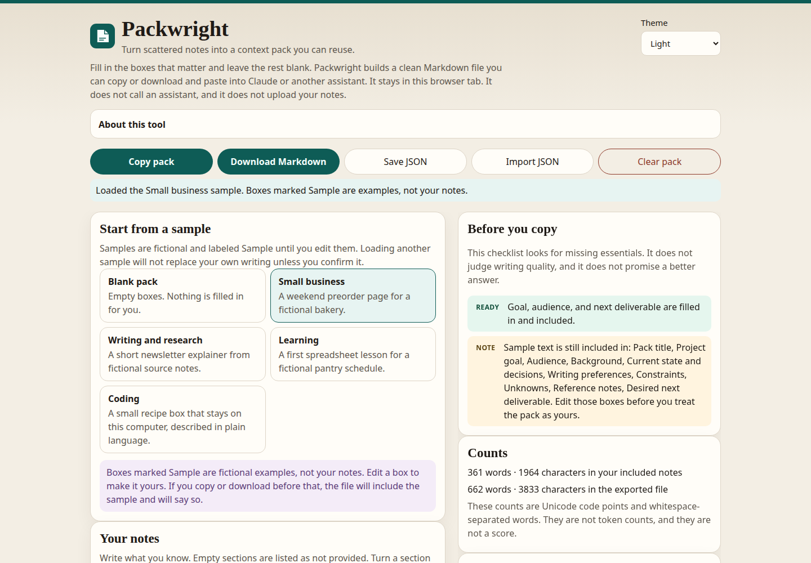
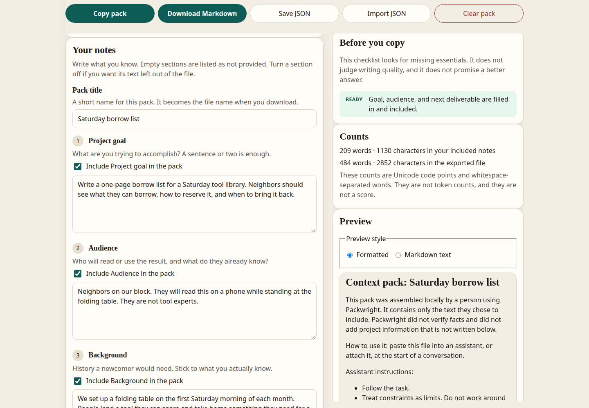
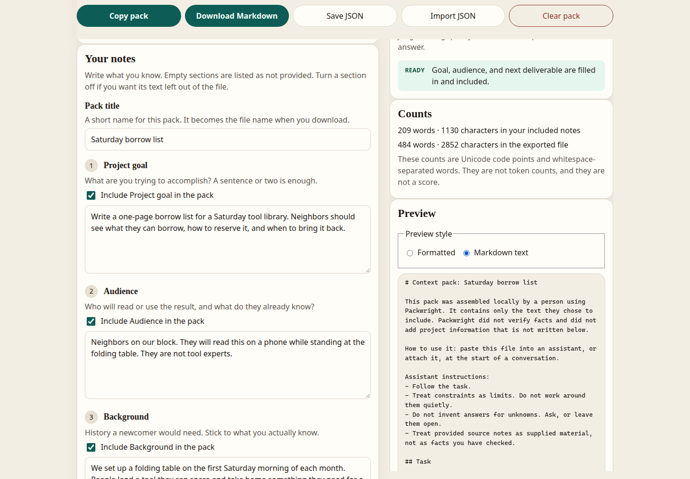
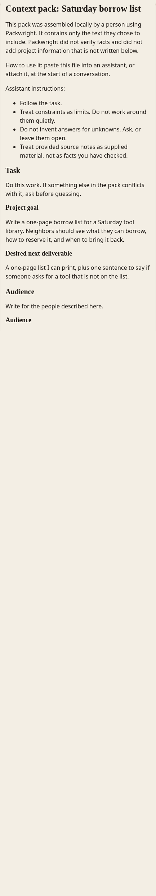
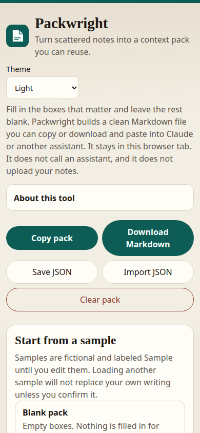
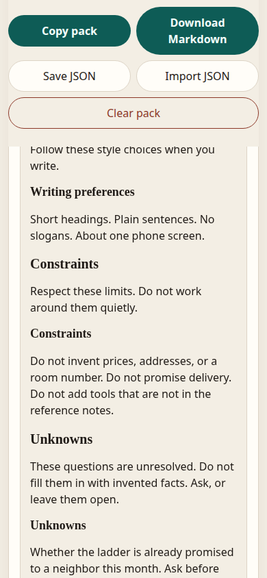
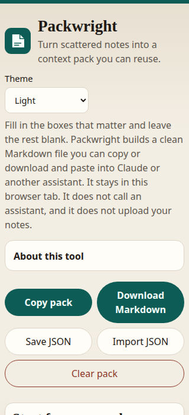
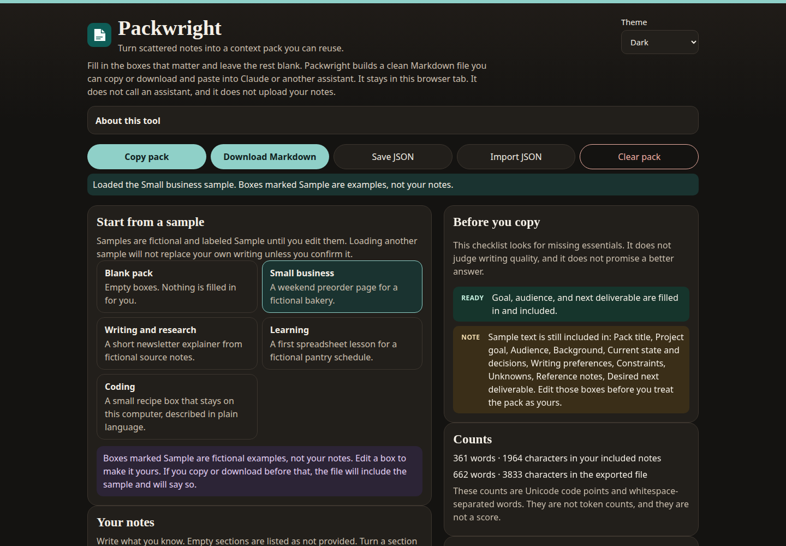

# Packwright

Turn scattered project notes into a clean context file you can paste into Claude or another assistant.



Packwright is one HTML file. Open it in a browser and it works with the internet off. There is no account, no install, and no upload. You write the brief. The file keeps the task, the limits, the open questions, and your source notes in separate sections, so an assistant can follow the work without treating your notes as checked facts.

Packwright is an independent tool by Amit Shrivastava. It is not affiliated with Anthropic, Claude, or any other assistant product.

## Download and open

The app is the single file [`dist/packwright.html`](dist/packwright.html) in this repository. Screenshot paths such as `assets/desktop-hero.png` are relative to this README, so they resolve on the same branch as the file you are reading.

The branch that contains this copy of the app is `cursor/upload-packwright-app-82c1`.

- File page: https://github.com/swiftverse/Packwright/blob/cursor/upload-packwright-app-82c1/dist/packwright.html
- Raw download: https://raw.githubusercontent.com/swiftverse/Packwright/cursor/upload-packwright-app-82c1/dist/packwright.html

1. Download [`dist/packwright.html`](dist/packwright.html). On GitHub, open the file page and use Download raw file, or save the raw download link above.
2. Open the downloaded file. Double-click it, or drag it into Chrome, Firefox, or Safari.
3. Fill in the boxes you have answers for. Leave the rest blank.
4. Choose **Copy pack** or **Download Markdown**, then paste or attach the file at the start of a chat.

You do not need Node, a build step, or a network connection to use the downloaded file. Building from source is only for people who want to change the code.

## A pack, before and after

Packwright does not read a messy note for you. You sort the pieces into the boxes. This is the kind of note someone might start with for a neighborhood tool library:

```text
saturday tool thing
neighbors, phone, at the table
we have hammer, ladder, 2 sawhorses
no money, no delivery, don't make up a price or address
not sure if the ladder is free — ask
print a one page list
```

The same points, written into the form. The panel on the right is the live preview, not a separate document:



Switch the preview to **Markdown text** and you are looking at the file **Download Markdown** will save:



That export is saved in full as [`assets/example-saturday-borrow.md`](assets/example-saturday-borrow.md). These pieces are copied from that file. The skipped lines are the how-to-use note, the audience, and the writing preferences.

```markdown
# Context pack: Saturday borrow list

## Task

### Project goal

Write a one-page borrow list for a Saturday tool library. Neighbors should see what they can borrow, how to reserve it, and when to bring it back.

### Desired next deliverable

A one-page list I can print, plus one sentence to say if someone asks for a tool that is not on the list.

## Constraints

Respect these limits. Do not work around them quietly.

### Constraints

Do not invent prices, addresses, or a room number. Do not promise delivery. Do not add tools that are not in the reference notes.

## Unknowns

These questions are unresolved. Do not fill them in with invented facts. Ask, or leave them open.

### Unknowns

Whether the ladder is already promised to a neighbor this month. Ask before writing that it is available.

## Provided source notes

### Reference notes

Hammer. Ladder. Two sawhorses. Pickup is at the folding table from 9:00 to 11:00. Bring borrowed tools back the next Saturday.
```

For this example the screen reported **209 words and 1,130 characters** in the included notes, and **484 words and 2,852 characters** in the whole file. Those are Unicode code points and whitespace-separated words. They are not token counts. The footer inside the file repeats the notes count so the file can stand on its own.

The formatted preview of the whole pack is a tall page:



## On a phone

The same page at 390 pixels wide. Buttons wrap, and the form stays on the screen:



Further down, the preview still separates limits from open questions:



A 320 pixel width was checked as well. The actions still fit:



## What you can do

- Walk through nine boxes: project goal, audience, background, current state and decisions, writing preferences, constraints, unknowns, reference notes, and the next deliverable.
- Start from a blank pack, or from one of four fictional samples. A **Sample** label stays on a box until you edit it.
- Turn any section off. Its text stays in the form and is left out of the file. The file says the section was left out on purpose, without quoting it.
- Read a live preview as formatted text or as the Markdown source. Formatting is drawn with plain text nodes. HTML and script you paste is shown as text.
- Copy the pack. If the browser blocks clipboard access, Packwright selects the pack in a box and tells you to press Ctrl+C or Command+C.
- Download Markdown or a JSON copy. Import that JSON later. A bad, oversized, or unfamiliar file is rejected and the form is left as it was.
- See a checklist of missing essentials, plus word and character counts. There is no quality score and no token estimate.
- Choose a light theme, a dark theme, or match the system for this visit. The choice is not stored.



Switching samples, clearing the pack, or importing over writing you have typed asks first. Cancel leaves your notes in place.

## The four samples

Each sample is fiction, and the background box says so. They are there to show a finished pack, not to describe a real business or person.

| Sample | What it demonstrates |
| --- | --- |
| Small business | A weekend preorder page for the fictional bakery Hearth & Rye, with a fixed menu and rules the page must not invent past. |
| Writing and research | A newsletter explainer for fictional North Ward Notes, limited to the editor’s source notes. |
| Learning | A first spreadsheet lesson for a fictional pantry shift grid, written for someone new to formulas. |
| Coding | A one-file recipe box called Kitchen Card Box, described in plain language, with no account and no network. |

Edit any box and the **Sample** label on that box goes away. Downloading before you edit includes the sample and says so at the top of the file.

## Privacy and where your notes go

```text
You type in this tab
        |
        +--> stays in the tab until you close it
        |
        +--> Copy or Download, only when you use those buttons
        |
        +--> optional draft in this browser, only if you turn it on
        |
        X  Packwright does not send the pack to a server
```

Saving a draft is off until you check **Keep a draft in this browser**. The disclosure next to that box is part of the page, not a separate policy site.

If you turn it on:

- The browser stores the pack in its ordinary local storage, on this device, for this file’s origin.
- Packwright does not encrypt that copy. Anyone who can open this browser profile can read it.
- Nothing is transmitted. Turning saving off deletes the stored copy. The notes still on screen stay until you reload or close the tab.
- If storage is blocked or full, the page says so and leaves the text in the tab. Download a file if you need a copy the browser cannot hold.
- A draft is not a backup. Browsers can clear site data. The JSON or Markdown file is the copy you control.

Other limits:

- Do not put passwords, payment numbers, or other secrets in a pack. The page cannot hide them, and a file you paste into an assistant has left your computer.
- The form asks the browser not to keep field history (`autocomplete` is off). Browsers do not always honor that. Packwright does not control the browser’s own history.
- An imported file is data. It is not run. Files over 750,000 bytes, files that are not version 1 of the `packwright.context-pack` schema, and files with fields this version does not know are rejected. Unknown content is not merged into a half-loaded pack.
- The theme choice lasts for the visit only. It is not written to storage.

## Tests and limits

The commands and results from this project’s test runs are in [TEST-REPORT.md](TEST-REPORT.md). The repository upload on 2026-11-07 ran the 30 unit tests again and the same 25 browser tests on Chromium, Firefox, and WebKit. Timings for that run are in the report, separate from the earlier run.

In short: 30 unit tests and 25 browser tests. The browser tests passed in Chromium, Firefox, and WebKit. They cover an empty pack, each sample, confirm-before-replace, section on/off, Markdown and JSON round trip, bad imports, clipboard success and the manual fallback, local drafts (including blocked storage and a full quota), keyboard labels, and layout at desktop, 390px, and 320px widths. A `file://` open was checked with no web request from the page.

What this project does not claim:

- It does not count tokens, and it does not score the writing.
- It does not encrypt notes or drafts.
- It does not parse PDFs, Word files, or web pages. Paste and edit.
- Character counts are Unicode code points. A family emoji can count as more than one character.
- WebKit may show spaces in a suggested download name as underscores. The file contents are unchanged. Chromium and Firefox kept the spaces in the test run.
- Playwright cannot grant clipboard permissions in Firefox or WebKit. Those browsers still had to show a successful copy or the manual box, and the blocked-copy box was required on all three.
- The engines tested were Playwright’s Chromium, Firefox, and WebKit on Linux. Windows, macOS Safari outside that WebKit build, and real phones were not tested. The narrow layouts were resized desktop windows, not device hardware.
- Very old browsers without `<dialog>`, blob downloads, or `localStorage` were not tested.

## Develop

```bash
node scripts/build.js
node scripts/serve.js
```

The build writes `dist/packwright.html`. `node scripts/serve.js` serves only that file and prints the local address it is using. The default port is 47321.

```bash
npm install
npx playwright install chromium
npm test
```

`npm test` builds, runs the unit tests, then the Chromium browser tests. Firefox and WebKit are optional:

```bash
PW_FIREFOX=1 npx playwright test --project=firefox
PW_WEBKIT=1 npx playwright test --project=webkit
```

Runtime dependencies: none. The HTML file contains its own CSS and script. Development tests use Node’s built-in test runner and Playwright. Playwright is Apache-2.0 and is not copied into the HTML file. See [LICENSES.md](LICENSES.md). That inventory is not a legal opinion and not a promise of zero risk.

`package.json` is marked `private` so npm will not publish this folder by accident.

### JSON schema

Version 1. Top-level fields are `schema` (`packwright.context-pack`), `schemaVersion` (`1`), `title`, `titleSample`, and `sections`. Each section has `included` (boolean), `text` (string), and `sample` (boolean). Extra fields are rejected so an incompatible file cannot be applied halfway.

## License

Copyright (c) 2026 Amit Shrivastava. Released under the MIT License. See [LICENSE](LICENSE).

Packwright is an independent tool. It is not affiliated with Anthropic, Claude, or any assistant product.
